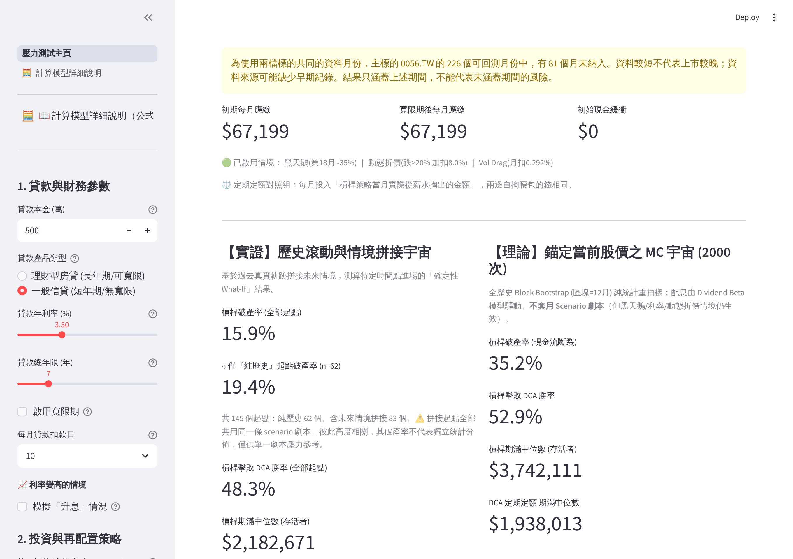
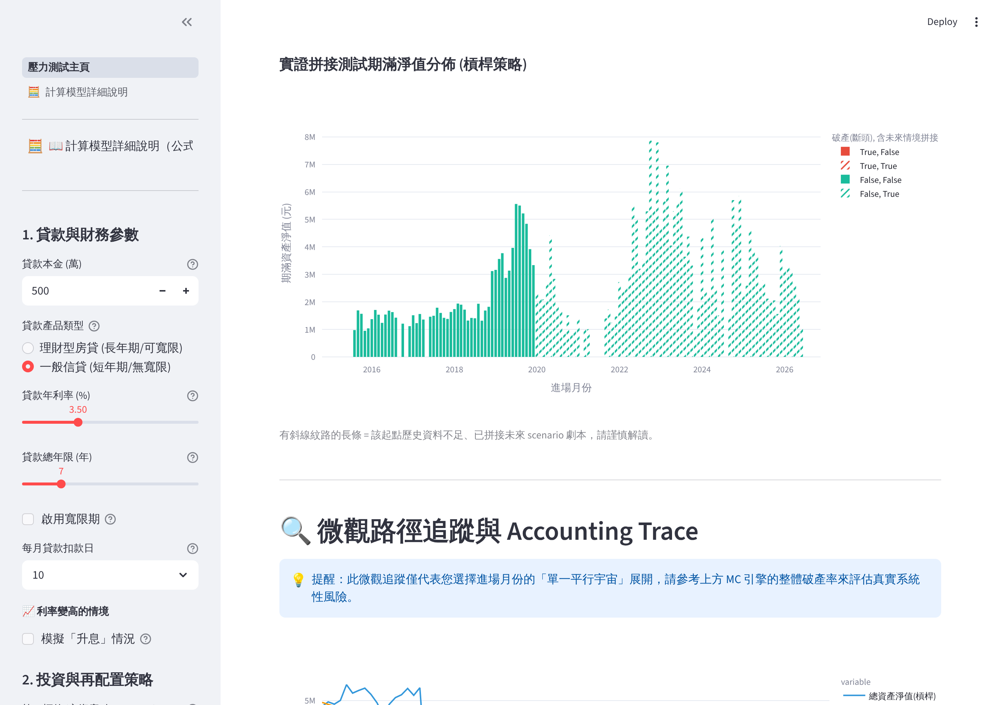
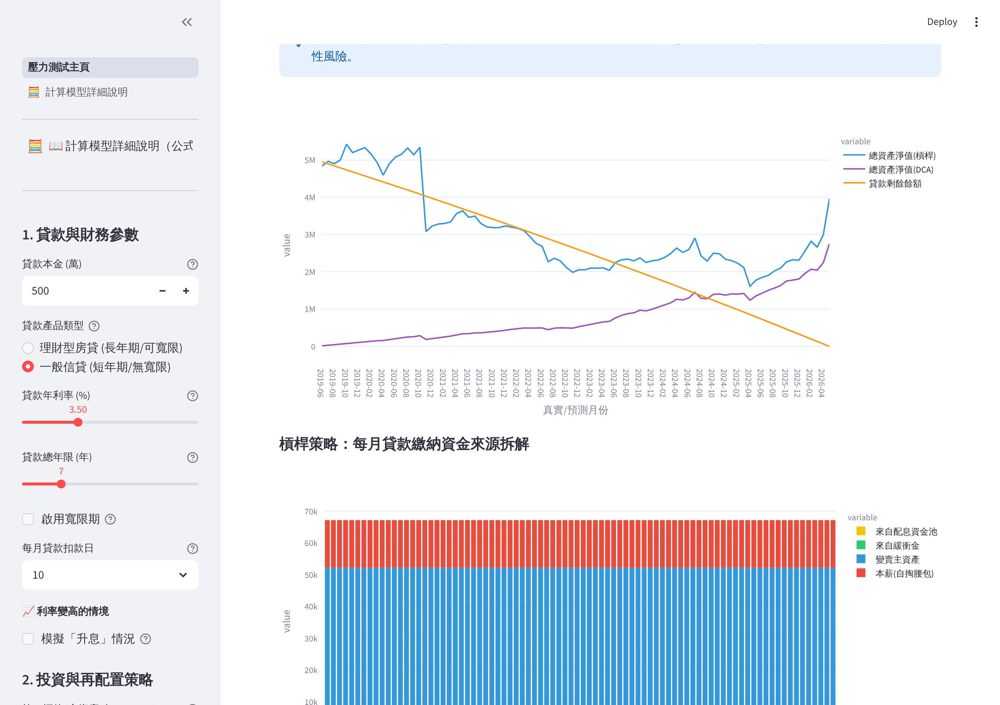
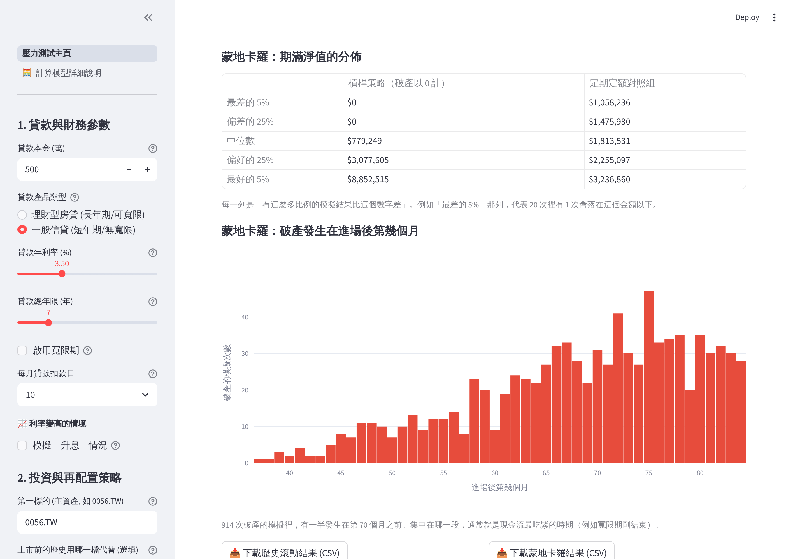

# ETF Leverage & Carry Stress-Test Engine (V34)

> You borrowed to invest. Can you keep making the monthly payment? A stress-testing tool for leveraged investing, built around the risk of running out of cash.

**🔗 Live demo:** https://etf-leverage-stress-test.streamlit.app　|　[中文說明](README.md)

The app's interface is in Traditional Chinese.



---

## What problem does it solve?

A conventional backtest asks one question: **"If I buy and hold, how much do I end up with?"**

This tool asks a more practical one: **"If the money was borrowed and a loan payment is due every month, does the strategy survive long enough to get there?"**

It tracks two sides at once:

- **Assets** — the market value of the stock or ETF, and the dividends it pays.
- **Liabilities** — the monthly loan payment, the jump when an interest-only period ends, and rate rises.

The first month in which the payment cannot be covered, the strategy is **ruined**. That state is absorbing: a later rally makes no difference.

## Features

- **Two risk engines**
  - 🅰 **Rolling history with scenario splicing** — every past month is treated as an entry point. Where real history is shorter than the loan, the remainder is filled with a chosen scenario (for example a 2008-style crash and recovery).
  - 🅱 **Monte Carlo (block bootstrap)** — resamples real monthly returns in blocks, which keeps multi-month crashes intact, and reports the share of simulated futures that end in ruin.
- **Realistic loan model** — level amortisation, interest-only grace period with the payment jump afterwards, and a rate shock that recomputes the payment on the outstanding balance.
- **Dividend model** — payouts rise and fall with the market (dividend beta), with a floor during crashes.
- **Repayment waterfall** — dividend pool, cash buffer, selling the asset and salary are drawn in the order you choose; any of them can be left out.
- **Fire-sale discount** — forced selling in a crash month costs extra.
- **Leveraged-ETF compounding and volatility decay** — months in which the second asset has no real data are modelled from the first with the standard leveraged-fund formula, without projecting any excess return it earned in the sample.
- **Longer history** — a recently listed asset can borrow the pre-listing record of a similar, older one, so the test covers bear markets such as 2008.
- **Data checks and repairs** — splits and dividend units the data source left unadjusted are repaired and reported, outliers are flagged, and the last good download is used when the source is unreachable. See [DATA_NOTES.md](DATA_NOTES.md) (in Chinese).
- **Job-loss scenarios** — a fixed window, or a random model in which unemployment becomes more likely when the market crashes.
- **DCA comparison** — every path also runs a no-loan portfolio that invests monthly. By default it invests exactly what the leveraged strategy took from salary that month, so both sides put in the same money.
- **Readable results** — the ruin rate comes with a plain-language reading and its sampling error, plus the distribution of final net worth, the timing of ruin, and CSV downloads.
- **Shareable links** — the address bar always carries the current settings. Copy the URL to hand someone the same scenario; a page refresh keeps your inputs.
- Every input has a plain-language tooltip, and a separate page lists the formulas and model assumptions.

## Screens

| Outcome for every historical entry month | Month-by-month ledger for one entry month |
|---|---|
|  |  |



The screenshots use this scenario, which you can reproduce by appending it to the app's URL:
`?a=0056.TW&salary=15000&swan=1&swan_m=18&swan_d=35&hc=1&m=2019-06`

## Tech stack

| Area | Tools |
|------|-------|
| App framework | Streamlit |
| Market data | yfinance (prices and dividends for Taiwan and other markets) |
| Numerics | NumPy, pandas |
| Charts | Plotly |

## Run locally

```bash
git clone https://github.com/Wayweiwayne/ETF-Leverage-Stress-Test.git
cd ETF-Leverage-Stress-Test

python -m venv .venv
.venv\Scripts\activate        # Windows
# source .venv/bin/activate   # macOS / Linux

pip install -r requirements.txt
streamlit run app.py
```

The app opens at `http://localhost:8501`.

## Project layout

| File | Contents |
|------|----------|
| `engine.py` | The simulation engine: loan schedule, repayment waterfall, rolling history and Monte Carlo. NumPy and pandas only, with no Streamlit dependency, so it can be imported on its own. |
| `market_data.py` | Fetching with snapshot fallback, split repair and outlier checks, month alignment, pre-listing backfill. |
| `main_page.py` | The main page: collects inputs, calls the engine, draws the charts. |
| `ui_state.py` | Input defaults, bounds and URL synchronisation. |
| `pages/1_Model_Details.py` | Formulas and model assumptions. |
| `app.py` | Entry point and page navigation. |
| `version.py` | Version label. Changes are listed in [CHANGELOG.md](CHANGELOG.md) (in Chinese). |

Using the engine without the UI:

```python
import engine
from market_data import load_history, monthly_data, align_months

data = align_months(monthly_data(load_history("0056.TW"), 10))
params = engine.SimParams(principal=5_000_000, annual_rate_pct=3.5, total_months=84,
                          reinvest=False, salary_cap=25_000, seed=42)
result = engine.run_summary(data, params)
print(result.mc["Is_Ruined"].mean())      # Monte Carlo ruin rate
print(result.hist["Ruin_Prob"].mean())    # average ruin rate over every historical entry month
print(engine.run_trace(data, params, anchor_idx=0).head())   # ledger for the first entry month
```

## Tests

```bash
python -m unittest -v
```

The tests need no network access: the engine is checked against synthetic data, and the UI tests run the whole app on stubbed market data. GitHub Actions runs them on Python 3.11, 3.12 and 3.13 on every push (`.github/workflows/tests.yml`).

## Disclaimer

This project is a financial-engineering and software showcase. Everything it outputs is for education and research only and **is not investment advice**. Borrowing to invest carries a high risk of loss; make your own careful assessment.
