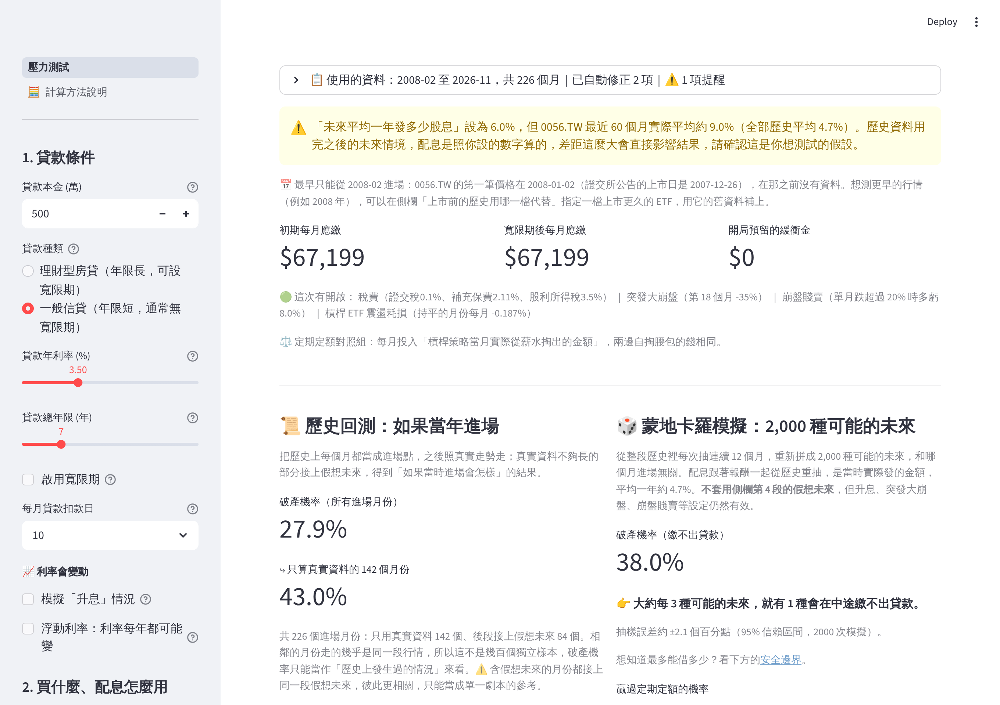
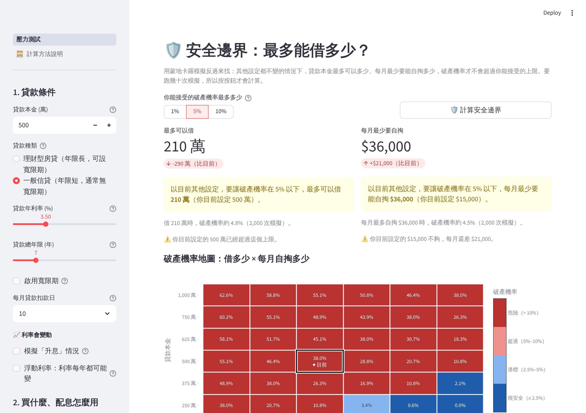
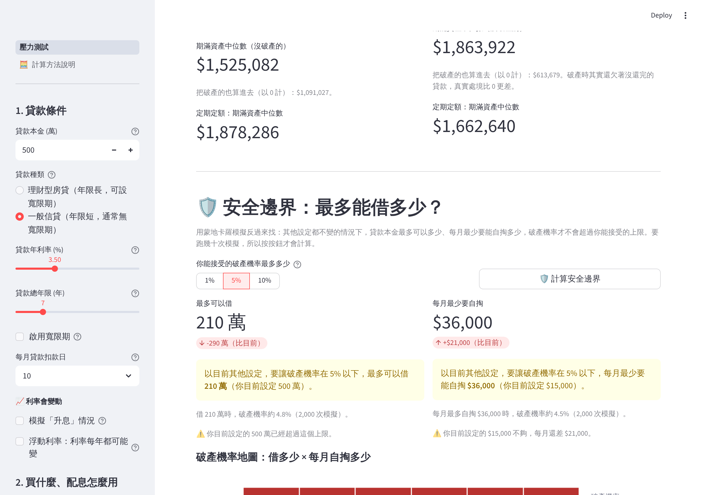
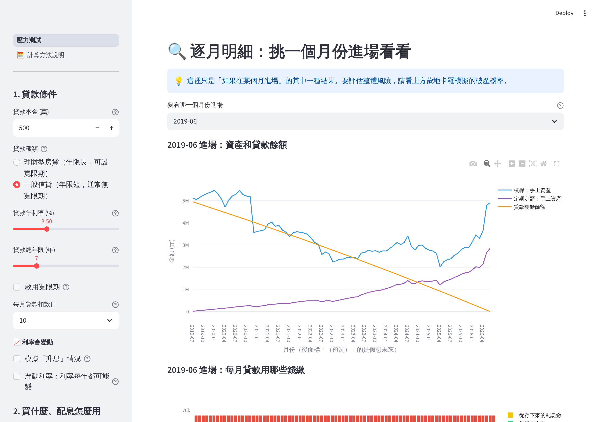
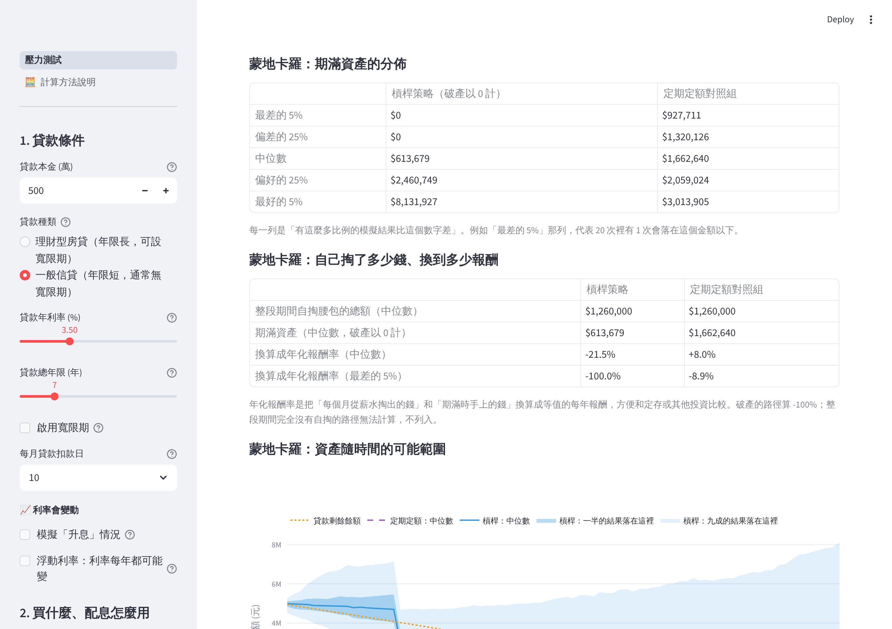

# ETF 槓桿與利差套利：壓力測試引擎 (V40)

> 借錢投資，撐得住每月還款嗎？——一個以「破產風險」為核心的槓桿投資壓力測試系統。

**🔗 線上試用：** [etf-leverage-stress-test.streamlit.app](https://etf-leverage-stress-test.streamlit.app) ｜ [English README](README.en.md)



---

## 這個專案在解決什麼問題？

傳統的投資回測只問一件事：**「買了放著，最後賺多少？」**

這個系統多問了一個更現實的問題：**「如果這筆投資是借錢來的、每個月都得還貸款，那在還款壓力下，這個策略還活得下去嗎？」**

它同時追蹤兩條線：

- **資產端** — 股票 / ETF 的市值、配息現金流。
- **負債端** — 每月本息攤還、寬限期跳升、升息衝擊。

只要某個月「湊不出錢繳貸款」，策略即判定**破產**。

## 主要功能

- **兩種方法評估風險**
  - 📜 **歷史回測**：把歷史上每個月都當成進場點，看「如果當年進場會怎樣」；真實資料不夠長的部分接上你選的假想未來（例如 2008 年那樣的崩盤）。
  - 🎲 **蒙地卡羅模擬**：從歷史裡一段一段抽出來重新拼接（保留崩盤的連續性），模擬上千種可能的未來並統計破產機率。
- **安全邊界**：反過來算「以目前其他設定，最多能借多少」「每月最少要能自掏多少」，破產機率才不會超過你能接受的上限（1%、5% 或 10%），並用一張「借多少 × 每月自掏多少」的破產機率地圖畫出安全範圍。
- **信貸額度檢查**：選一般信貸並填平均月收入，就依「無擔保債務不得超過月收入 22 倍」估算你最多能借多少；輸入超過上限時，改以上限計算並明確告訴你。
- **真實負債模型**：本息平均攤還、寬限期後還款跳升、指定年份升息重算；也可以排定逐年的浮動利率，並讓蒙地卡羅加上隨機升降息。
- **動態配息模型**：配息隨市場榮枯起伏（Dividend Beta），並設有崩盤保底機制；可設定每月、每季、每半年或每年發放。
- **稅與費用**：證交稅、二代健保補充保費、股利所得稅、貸款開辦費，預設採台灣現行費率。
- **還款資金的動用順序**：薪水、存下來的配息、緩衝金、賣第一標的、賣第二標的，依你排的優先序動用，全部用完才判定破產；任何一項都可以排除。
- **崩盤流動性折價**：大跌月份被迫賣股時額外計入賤賣損失。
- **槓桿 ETF 的複利與波動耗損**：第二標的沒有真實資料的月份，以槓桿 ETF 的標準公式由第一標的推估，且不外推歷史上的超額報酬。
- **較長的歷史**：第一標的上市不久時，可指定一檔性質相近的標的補上市前的歷史，讓回測涵蓋 2008 年這類空頭。
- **資料檢查與修正**：自動還原行情來源沒處理的股票分割與配息單位、提示異常值，並列出修正了什麼；來源連不上時改用最近一次的存檔。詳見 [DATA_NOTES.md](DATA_NOTES.md)。
- **定期定額（DCA）對照組**：每條路徑同時跑定期定額，比較「一次重壓 vs 分批進場」。對照組每月投入的金額，預設等於槓桿策略當月實際從薪水掏出的錢，兩邊自掏腰包的總額相同。
- **看得懂的結果**：破產率附白話說明與抽樣誤差，另有期滿資產的分佈、資產隨時間的可能範圍、自掏總額與年化報酬率、破產發生時間；
  結果可下載 CSV，也可以下載一份包含設定、數字和圖表的 HTML 報告。
- **分享連結**：網址列會自動帶著目前的所有設定，複製網址就能把同一組參數傳給別人；重新整理頁面也不會遺失設定。
- 每個參數旁附白話問號說明，另有獨立頁面詳列公式與模型假設。

## 畫面



| 歷史上每個進場月份的期滿結果 | 挑一個月份進場的逐月明細 |
|---|---|
|  |  |



上圖的設定可以直接用這個連結重現：
`?a=0056.TW&salary=15000&swan=1&swan_m=18&swan_d=35&hc=1&m=2019-06`（接在網址後面；安全邊界要再按「計算安全邊界」）。

## 技術棧

| 類別 | 使用工具 |
|------|----------|
| 前端 / App 框架 | Streamlit |
| 資料來源 | yfinance（即時抓取台股 / ETF 歷史股價） |
| 數值運算 | NumPy, pandas |
| 視覺化 | Plotly |

## 單機版（單一 HTML 檔）

[`dist/ETF-Leverage-Stress-Test.html`](dist/ETF-Leverage-Stress-Test.html) 是把整個 App 打包成的單一檔案：下載後用瀏覽器打開就能用，不需要安裝 Python。

- 第一次打開需要連網，下載約 30 MB 的 Python 執行環境（[stlite](https://github.com/whitphx/stlite)／Pyodide），之後瀏覽器會快取。
- 計算全部在你的電腦上進行。
- 可以使用所有台灣上市的 ETF（每天自動更新）；上市 ETF 以外的商品要用網頁版。連不上存檔時，改用檔案內建的 8 檔常用 ETF。
- 程式碼更新後要重新產生：`python build_standalone.py`（測試會檢查這個檔案是否過期）。

## 本機執行

```bash
git clone https://github.com/Wayweiwayne/ETF-Leverage-Stress-Test.git
cd ETF-Leverage-Stress-Test

python -m venv .venv
.venv\Scripts\activate        # Windows
# source .venv/bin/activate   # macOS / Linux

pip install -r requirements.txt
streamlit run app.py
```

瀏覽器會自動打開 `http://localhost:8501`。

## 專案結構

| 檔案 | 內容 |
|------|------|
| `engine.py` | 模擬引擎：貸款排程、還款資金的動用順序、歷史回測、蒙地卡羅模擬與安全邊界的求解。只用 NumPy / pandas，不依賴 Streamlit，可以單獨匯入使用。 |
| `market_data.py` | 行情抓取、存檔備援、分割還原與異常檢查、月份對齊、上市前歷史回補。 |
| `main_page.py` | 主頁畫面：收集參數、呼叫引擎、畫圖表。 |
| `ui_state.py` | 輸入元件的預設值、上下限與網址同步。 |
| `safety_limit.py` | 安全邊界區塊：搜尋範圍、結論句、破產機率地圖與報告內容。 |
| `report.py` | 產生可下載的 HTML 報告。 |
| `build_standalone.py` | 把整個 App 打包成單一 HTML 檔（`dist/`）。 |
| `pages/1_Model_Details.py` | 公式與模型假設說明頁。 |
| `app.py` | 進入點與頁面導覽。 |
| `version.py` | 版本號。更新內容見 [CHANGELOG.md](CHANGELOG.md)。 |

不透過畫面直接使用引擎：

```python
import engine
from market_data import load_history, monthly_data, align_months

data = align_months(monthly_data(load_history("0056.TW"), 10))
params = engine.SimParams(principal=5_000_000, annual_rate_pct=3.5, total_months=84,
                          reinvest=False, salary_cap=25_000, seed=42)
result = engine.run_summary(data, params)
print(result.mc["Is_Ruined"].mean())      # 蒙地卡羅破產率
print(result.hist["Ruin_Prob"].mean())    # 歷史上每個月進場的平均破產率
print(engine.run_trace(data, params, anchor_idx=0).head())   # 第一個進場月份的逐月明細
```

## 測試

```bash
python -m unittest -v
```

測試不需要網路：引擎以合成資料驗證，畫面測試則以假行情跑完整個 App。每次 push 都會由 GitHub Actions 在 Python 3.11、3.12、3.13 上自動執行（`.github/workflows/tests.yml`）。

另一個工作流程（`.github/workflows/refresh-data.yml`）每天更新常用標的的行情存檔並發布到 `market-data` 分支，App 會優先讀取這些存檔，細節見 [DATA_NOTES.md](DATA_NOTES.md)。

## 授權

Copyright (C) 2026 Wayweiwayne

本專案的程式碼以 [GNU Affero General Public License v3.0](LICENSE)（AGPL-3.0）授權。你可以自由使用、修改與散布；
但只要散布修改後的版本，或把它架成網站、服務提供給別人使用，就必須以同樣的授權公開你的完整原始碼。
本程式不提供任何擔保，詳見授權條文。

授權只涵蓋程式碼。`data/snapshots/` 裡的行情資料來自 Yahoo Finance，權利屬於原資料來源，不在這份授權的範圍內。

## 免責聲明

本專案為財務工程與程式作品展示，所有輸出僅供教育與研究用途，**不構成任何投資建議**。槓桿與借貸投資具高度風險，請自行審慎評估。
