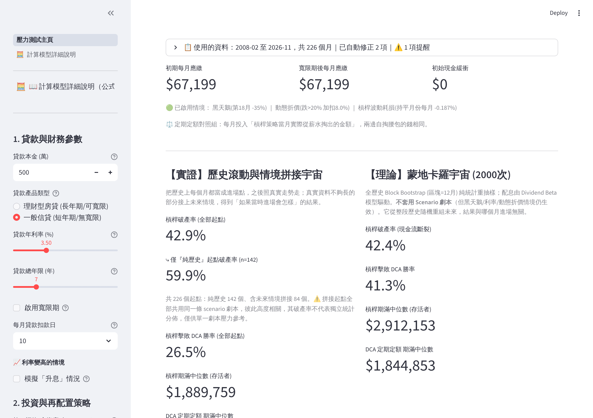
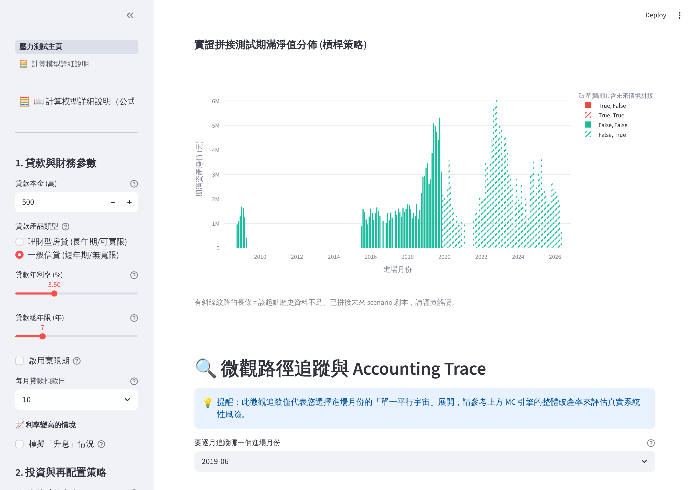
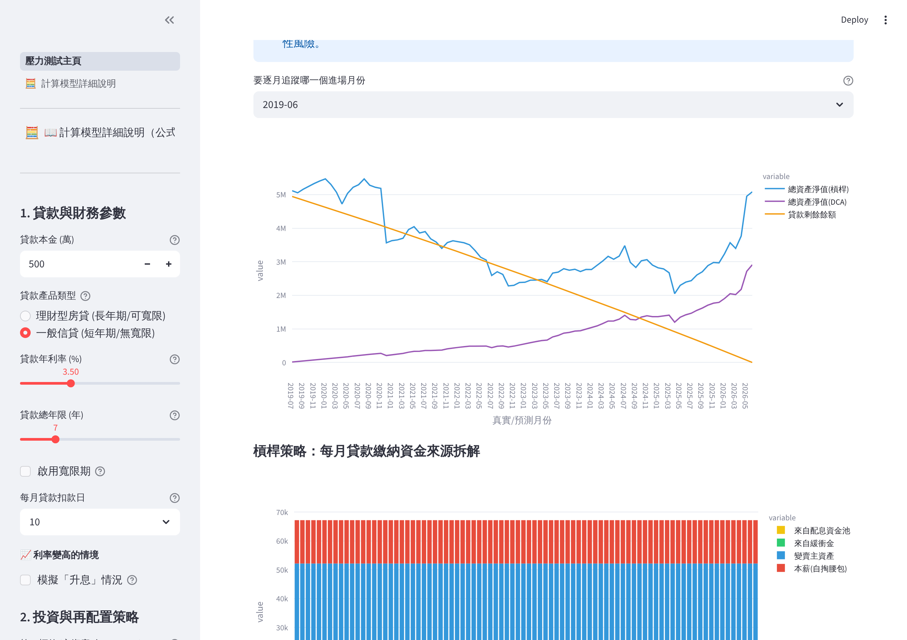

# ETF 槓桿與利差套利：壓力測試引擎 (V33)

> 借錢投資，撐得住每月還款嗎？——一個以「破產風險」為核心的槓桿投資壓力測試系統。

**🔗 線上試用：** https://etf-leverage-stress-test.streamlit.app　｜　[English README](README.en.md)



---

## 這個專案在解決什麼問題？

傳統的投資回測只問一件事：**「買了放著，最後賺多少？」**

這個系統多問了一個更現實的問題：**「如果這筆投資是借錢來的、每個月都得還貸款，那在還款壓力下，這個策略還活得下去嗎？」**

它同時追蹤兩條線：

- **資產端** — 股票 / ETF 的市值、配息現金流。
- **負債端** — 每月本息攤還、寬限期跳升、升息衝擊。

只要某個月「湊不出錢繳貸款」，策略即判定**破產**（財務工程上的「吸收邊界」——掉進去就出不來），後續就算市場大漲也與你無關。

## 主要功能

- **雙引擎風險評估**
  - 🅰 **歷史滾動 + 情境拼接**：以歷史每個月為進場點做確定性 What-If；資料不足的未來以指定劇本（如 2008 復刻）補齊。
  - 🅱 **蒙地卡羅（Block Bootstrap）**：分段重抽歷史報酬、保留崩盤的連續性，模擬上千種未來並統計破產機率。
- **真實負債模型**：本息平均攤還、寬限期後還款跳升、指定年份升息重算。
- **動態配息模型**：配息隨市場榮枯起伏（Dividend Beta），並設有崩盤保底機制。
- **還款資金瀑布**：配息池 → 緩衝金 → 變賣資產 → 本薪，依優先序動用直到破產判定。
- **崩盤流動性折價**：大跌月份被迫賣股時額外計入賤賣損失。
- **槓桿 ETF 的複利與波動耗損**：第二標的沒有真實資料的月份，以槓桿 ETF 的標準公式由第一標的推估，且不外推歷史上的超額報酬。
- **較長的歷史**：第一標的上市不久時，可指定一檔性質相近的標的補上市前的歷史，讓回測涵蓋 2008 年這類空頭。
- **資料檢查與修正**：自動還原行情來源沒處理的股票分割與配息單位、提示異常值，並列出修正了什麼；來源連不上時改用最近一次的存檔。詳見 [DATA_NOTES.md](DATA_NOTES.md)。
- **DCA 對照組**：每條路徑同時跑定期定額，比較「一次重壓 vs 分批進場」。對照組每月投入的金額，預設等於槓桿策略當月實際從薪水掏出的錢，兩邊自掏腰包的總額相同。
- **分享連結**：網址列會自動帶著目前的所有設定，複製網址就能把同一組參數傳給別人；重新整理頁面也不會遺失設定。
- 每個參數旁附白話問號說明，另有獨立頁面詳列公式與模型假設。

## 畫面

| 歷史上每個進場月份的期滿結果 | 單一進場月份的逐月追蹤 |
|---|---|
|  |  |

上圖的設定可以直接用這個連結重現：
`?a=0056.TW&salary=15000&swan=1&swan_m=18&swan_d=35&hc=1&m=2019-06`（接在網址後面）。

## 技術棧

| 類別 | 使用工具 |
|------|----------|
| 前端 / App 框架 | Streamlit |
| 資料來源 | yfinance（即時抓取台股 / ETF 歷史股價） |
| 數值運算 | NumPy, pandas |
| 視覺化 | Plotly |

## 本機執行

```bash
git clone https://github.com/Wayweiwayne/ETF-Leverage-Stress-Test.git
cd ETF-Leverage-Stress-Test

python -m venv .venv
.venv\Scripts\activate        # Windows
# source .venv/bin/activate   # macOS / Linux

pip install -r requirements.txt
streamlit run app.py
```

瀏覽器會自動打開 `http://localhost:8501`。

## 專案結構

| 檔案 | 內容 |
|------|------|
| `engine.py` | 模擬引擎：貸款排程、還款資金瀑布、歷史滾動與蒙地卡羅。只用 NumPy / pandas，不依賴 Streamlit，可以單獨匯入使用。 |
| `market_data.py` | 行情抓取、存檔備援、分割還原與異常檢查、月份對齊、上市前歷史回補。 |
| `main_page.py` | 主頁畫面：收集參數、呼叫引擎、畫圖表。 |
| `ui_state.py` | 輸入元件的預設值、上下限與網址同步。 |
| `pages/1_Model_Details.py` | 公式與模型假設說明頁。 |
| `app.py` | 進入點與頁面導覽。 |

不透過畫面直接使用引擎：

```python
import engine
from market_data import load_history, monthly_data, align_months

data = align_months(monthly_data(load_history("0056.TW"), 10))
params = engine.SimParams(principal=5_000_000, annual_rate_pct=3.5, total_months=84,
                          reinvest=False, salary_cap=25_000, seed=42)
result = engine.run_summary(data, params)
print(result.mc["Is_Ruined"].mean())      # 蒙地卡羅破產率
print(result.hist["Ruin_Prob"].mean())    # 歷史上每個月進場的平均破產率
print(engine.run_trace(data, params, anchor_idx=0).head())   # 第一個進場月份的逐月明細
```

## 測試

```bash
python -m unittest -v
```

測試不需要網路：引擎以合成資料驗證，畫面測試則以假行情跑完整個 App。每次 push 都會由 GitHub Actions 自動執行（`.github/workflows/tests.yml`）。

## 免責聲明

本專案為財務工程與程式作品展示，所有輸出僅供教育與研究用途，**不構成任何投資建議**。槓桿與借貸投資具高度風險，請自行審慎評估。
